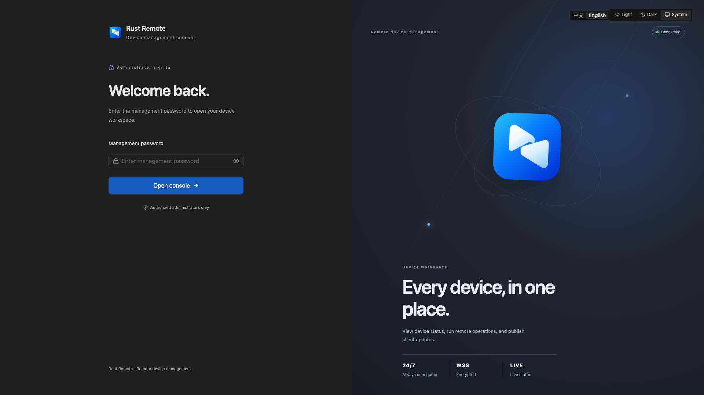
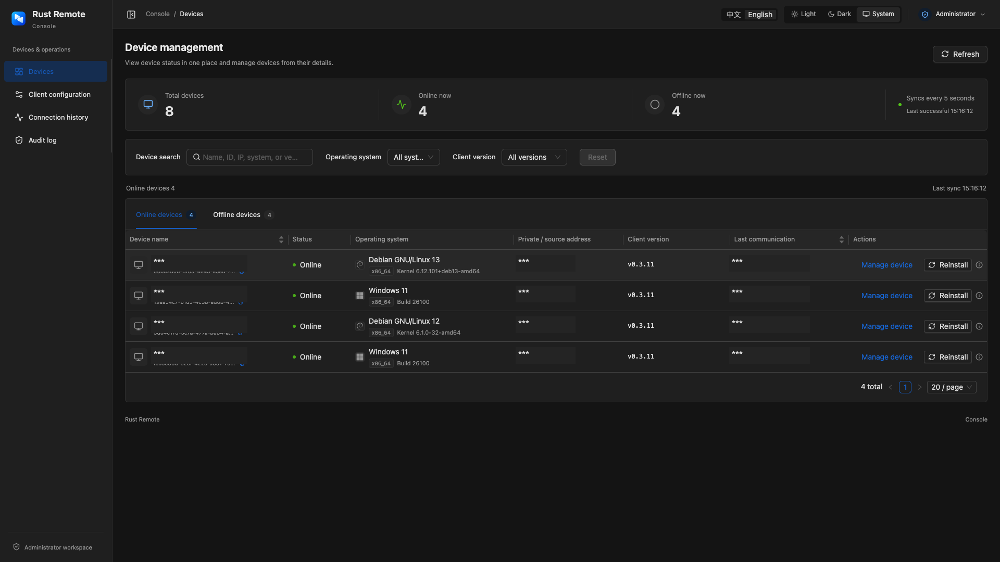
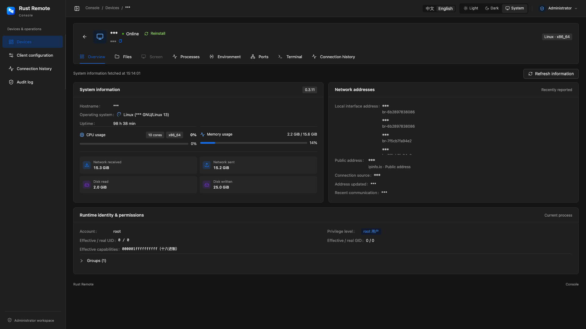

# Rust Remote

[简体中文](README_CN.md) · **English**

[](https://github.com/MicroMicroWhite/rust-remote/stargazers)
[](LICENSE)

A self-hosted remote device management platform for Windows and Linux. Rust Remote lets you manage devices from a browser, including system inspection, file operations, remote commands, terminal access, desktop control, and agent upgrades.

The Rust agent opens an outbound authenticated WebSocket connection and reconnects automatically. Managed devices do not need inbound ports or a public IP address.

## Screenshots

### Secure login

The protected entrance keeps the management console private while providing a focused administrator sign-in page.



### Device overview

The home screen summarizes total, online, and offline devices and provides quick filters for operating system, version, address, and status.



### Connection details

The device workspace brings together system resources, network addresses, runtime identity, processes, ports, files, terminal access, and connection history.



## Features

- Device status, system resources, network addresses, processes, ports, permissions, and audit records
- Remote screenshots, live desktop viewing, mouse and keyboard control, shortcuts, and Chinese text input
- Directory browsing, upload, download, create, rename, delete, and text editing
- Interactive Linux terminal and one-shot shell commands
- Agent builds and downloads for Windows/Linux on `x86_64` and `aarch64`
- Online upgrades and same-version redeployment with SHA-256 verification
- Password-protected console with a random entrance code and light/dark themes
- Cloudflare Tunnel support for agent connections without exposing an inbound port

## Requirements

- Docker Engine, Docker Compose v2, and Docker Buildx
- A Cloudflare remotely-managed Tunnel token and hostname
- The deployment host does not need Python, Node.js, or Rust

## Deploy

```bash
cp .env.example .env
docker compose up -d --build
docker compose ps
docker compose logs -f backend cloudflared
```

The first start generates an administrator password, agent token, and eight-character entrance code. They are saved in the `remote-data` volume at `/data/credentials.json`; the backend log prints the generated password and console URL.

Open the console on the private network:

```text
http://SERVER:8080/<ENTRANCE_CODE>/
```

No account or registration is required. Keep the `client/` directory on the deployment host because web builds read the agent source from this mounted directory.

### Environment variables

Copy [.env.example](.env.example) and set the values you need:

| Variable | Description |
| --- | --- |
| `HTTP_PORT` | Console port, default `8080` |
| `ADMIN_PASSWORD` | Console password; empty generates one, manual values need at least 12 characters |
| `AGENT_TOKEN` | Agent authentication token; empty generates one, manual values need at least 32 characters |
| `ENTRANCE_CODE` | Console URL code; empty generates one, manual values must be eight lowercase hexadecimal characters |
| `COOKIE_SECURE` | Set `true` when the console is served through HTTPS |
| `DOCKER_SOCKET_PATH` | Docker socket path, default `/var/run/docker.sock` |
| `DOCKER_GID` | Docker socket group ID, default `0` |
| `CLOUDFLARED_TUNNEL_TOKEN` | Cloudflare Tunnel token, required by Compose |
| `TUNNEL_HOSTNAME` | Tunnel hostname, required by the frontend build |

Web builds use the Docker socket. Restrict console access to trusted administrators.

## Cloudflare Tunnel

In Cloudflare Zero Trust:

1. Create a remotely-managed Tunnel and copy its token to `CLOUDFLARED_TUNNEL_TOKEN`.
2. Add a Public Hostname matching `TUNNEL_HOSTNAME`.
3. Set the service to `http://frontend:80`.

The hostname is reserved for the agent WebSocket path `/agent/ws`. Nginx rejects the console and management API on that hostname. Use the private server address or a separate HTTPS reverse proxy for the console.

A generated agent uses:

```text
wss://agent.example.com/agent/ws
```

## Add a device

1. Open **Agent Configuration**.
2. Enter the reachable control-plane address, such as `https://agent.example.com`. Enter only the scheme, host, and optional port; do not add `/agent/ws` or the console entrance code.
3. Choose Windows or Linux and `x86_64` or `aarch64`.
4. Generate and download the program, then run it on the target device.
5. Manage the device from **Device Management**.

For a trusted LAN, use `ws://SERVER:8080` and enable **Allow insecure LAN connections**. Public deployments should use HTTPS/WSS.

### Run the agent manually

Connection settings are resolved in this order: command-line arguments, runtime environment variables, then embedded build settings.

| Option | Environment variable | Purpose |
| --- | --- | --- |
| `--server` | `REMOTE_SERVER` | Full URL, for example `wss://agent.example.com/agent/ws` |
| `--token` | `REMOTE_TOKEN` | Agent token |
| `--name` | — | Display name; defaults to hostname |
| `--identity` | — | Identity file; preserving it preserves the device ID |
| `--root` | — | File-management root and initial terminal directory |
| `--disable-shell` | — | Disable terminal and one-shot commands |
| `--foreground` | — | Keep Linux in the foreground for systemd or another process manager |
| `--allow-insecure` | `REMOTE_ALLOW_INSECURE=true` | Allow `ws://` |

Linux:

```bash
chmod +x rust-remote-client
./rust-remote-client
```

Linux runs in the background by default and creates no log file. Use `kill <PID>` to stop it. Windows normal mode has no console window. Keep the identity file and agent token private.

### Windows service

Run PowerShell as administrator:

```powershell
.\rust-remote-client.exe --install-service --service-account local-service
```

The service is named `rust-client`. Windows service mode runs in Session 0, so it cannot control the desktop of the logged-in user and cannot use online upgrades. Use normal mode for desktop control.

## Upgrades

A successful build is published for its operating system and architecture. From **Device Management**, choose **Upgrade Agent** for a newer release or **Redeploy** for a supported same-version installation. Transfers verify file size and SHA-256 and preserve the device identity and connection settings.

The target program directory must be writable. Offline devices, Windows service mode, older agents without upgrade support, and downgrades require manual replacement.

## Limits and platform requirements

- Linux supports `x86_64` and `aarch64`; glibc 2.36+, matching `libxcb1`, `libxrandr2`, `libdbus-1-3`, and `libxkbcommon0` are required. Port inspection requires `iproute2`; desktop features require an accessible X11 session.
- Windows supports `x86_64` and `aarch64`; Windows 10 / Server 2016 or newer and the matching Visual C++ 2015–2022 runtime are required.
- Uploads and downloads are limited to 8 MiB; text editing is limited to 256 KiB.
- Each device supports up to two terminal sessions. Linux uses an interactive PTY; Windows uses one-shot commands. A one-shot command has a 1–30 second timeout and a 1 MiB output limit.
- `--root` sets the file-management boundary and initial directory; it is not a shell sandbox. Commands run with the agent account's permissions.
- The backend keeps device connections in process memory; run it with one worker process.

## Operations

```bash
docker compose ps
docker compose logs -f backend frontend cloudflared
docker compose up -d --build
```

`docker compose down` keeps the data volume. `docker compose down -v` deletes credentials, device records, audit data, and agent builds. Back up the `remote-data` volume, `.env`, and `client/` when migrating.

## Local development

The repository contains a FastAPI backend, React/Nginx console, Rust agent, and Compose deployment. For standalone development, the backend requires Python 3.11+ and `uv`; the frontend requires Bun. Compose remains the recommended way to run the complete stack.

## License

Rust Remote is released under the [MIT License](LICENSE).

## Star History

[](https://star-history.com/#MicroMicroWhite/rust-remote&Date)
