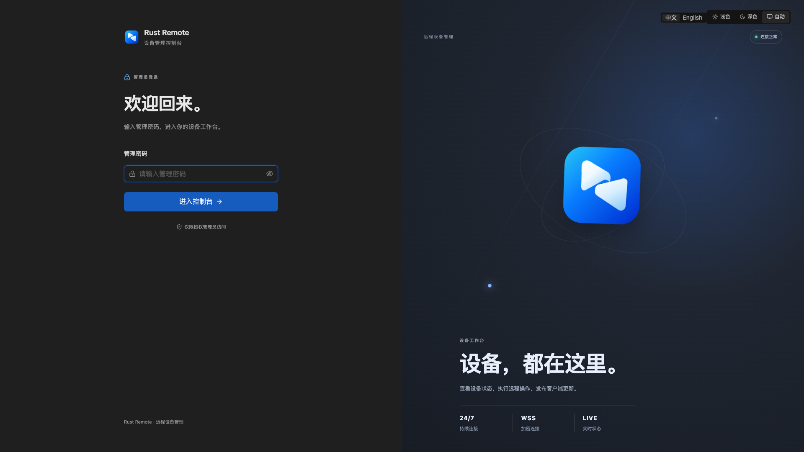
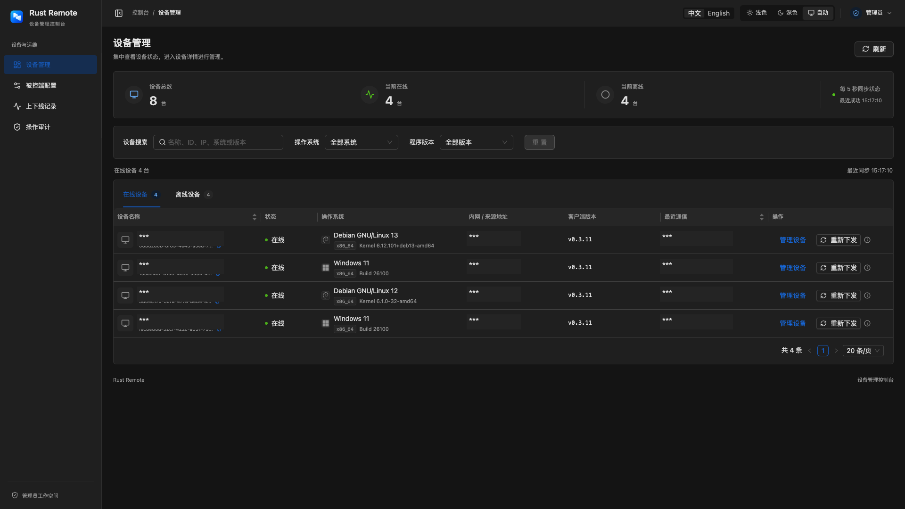
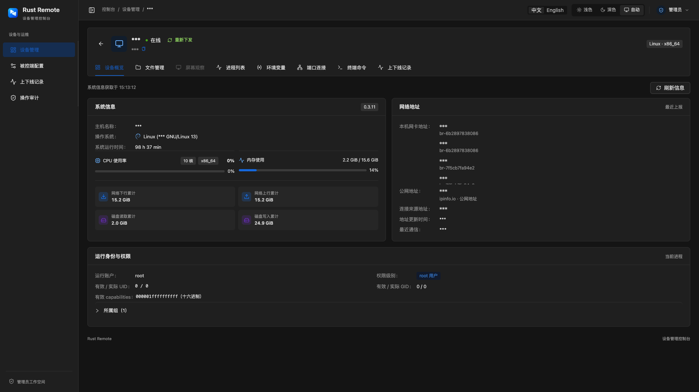

# Rust Remote

**简体中文** · [English](README.md)

[](https://github.com/MicroMicroWhite/rust-remote/stargazers)
[](LICENSE)

Rust Remote 是一个可自行部署的 Windows / Linux 远程设备管理平台。你可以通过浏览器查看设备状态、操作文件、执行命令、使用终端、控制桌面，并统一升级被控端程序。

被控端使用 Rust 编写，主动通过带认证的 WebSocket 连接主控并自动重连。设备无需开放入站端口，也不需要公网 IP。

## 项目截图

### 安全登录

安全入口保护管理控制台，并提供简洁的管理员登录页面。



### 设备总览

主页汇总设备总数、在线与离线状态，并支持按操作系统、版本、地址和状态筛选。



### 连接详情

设备工作台集中展示系统资源、网络地址、运行身份、进程、端口、文件、终端和上下线记录。



## 功能

- 设备在线状态、系统资源、网络地址、进程、端口、权限和操作审计
- 远程截图、连续画面、鼠标键盘控制、快捷键和中文输入
- 目录浏览、上传、下载、新建、重命名、删除和文本编辑
- Linux 交互式终端与单次 Shell 命令
- Windows / Linux 被控端编译与下载，支持 `x86_64` 和 `aarch64`
- 在线升级与同版本重新下发，传输后校验 SHA-256
- 密码登录、随机安全入口和浅色 / 深色主题
- Cloudflare Tunnel 接入，设备无需暴露入站端口

## 环境要求

- Docker Engine、Docker Compose v2、Docker Buildx
- Cloudflare remotely-managed Tunnel 令牌和域名
- 宿主机无需安装 Python、Node.js 或 Rust

## 部署

```bash
cp .env.example .env
docker compose up -d --build
docker compose ps
docker compose logs -f backend cloudflared
```

首次启动会生成管理员密码、设备令牌和 8 位安全入口，保存到 `remote-data` 数据卷的 `/data/credentials.json`。后端日志会显示生成的密码和控制台地址。

在内网打开控制台：

```text
http://服务器地址:8080/<安全入口>/
```

无需注册账号。部署目录中的 `client/` 会以只读方式挂载，网页编译依赖其中的被控端源码，请保留该目录。

### 环境变量

复制 [.env.example](.env.example)，按需修改：

| 变量 | 说明 |
| --- | --- |
| `HTTP_PORT` | 控制台端口，默认 `8080` |
| `ADMIN_PASSWORD` | 管理员密码；留空自动生成，手动设置至少 12 位 |
| `AGENT_TOKEN` | 被控端认证令牌；留空自动生成，手动设置至少 32 位 |
| `ENTRANCE_CODE` | 控制台入口；留空自动生成，手动设置必须为 8 位小写十六进制字符 |
| `COOKIE_SECURE` | 控制台通过 HTTPS 访问时设为 `true` |
| `DOCKER_SOCKET_PATH` | Docker Socket 路径，默认 `/var/run/docker.sock` |
| `DOCKER_GID` | Docker Socket 组 ID，默认 `0` |
| `CLOUDFLARED_TUNNEL_TOKEN` | Cloudflare Tunnel 令牌，Compose 必填 |
| `TUNNEL_HOSTNAME` | Tunnel 域名，前端构建必填 |

网页编译需要访问 Docker Socket，请只向可信管理员开放控制台。

## 配置 Cloudflare Tunnel

在 Cloudflare Zero Trust 中：

1. 创建 remotely-managed Tunnel，将令牌填入 `CLOUDFLARED_TUNNEL_TOKEN`。
2. 添加与 `TUNNEL_HOSTNAME` 相同的 Public Hostname。
3. 将 Service 指向 `http://frontend:80`。

该域名专用于被控端 WebSocket 路径 `/agent/ws`，Nginx 会拒绝该域名下的控制台页面和管理 API。控制台请通过服务器内网地址或单独的 HTTPS 反向代理访问。

生成的被控端连接地址为：

```text
wss://agent.example.com/agent/ws
```

## 添加设备

1. 打开控制台的「被控端配置」。
2. 填写被控设备可以访问的主控地址，例如 `https://agent.example.com`。这里只填写协议、域名和可选端口，不要填写 `/agent/ws` 或控制台安全入口。
3. 选择 Windows 或 Linux，以及 `x86_64` 或 `aarch64` 架构。
4. 生成并下载程序，在目标设备运行。
5. 在「设备管理」中使用设备功能。

可信内网可使用 `ws://服务器地址:8080`，并开启「允许内网明文连接」。公网环境请使用 HTTPS/WSS。

### 手动运行被控端

配置优先级为：命令行参数 → 运行时环境变量 → 编译时内置配置。

| 参数 | 环境变量 | 说明 |
| --- | --- | --- |
| `--server` | `REMOTE_SERVER` | 完整地址，例如 `wss://agent.example.com/agent/ws` |
| `--token` | `REMOTE_TOKEN` | 被控端令牌 |
| `--name` | — | 显示名称，默认使用主机名 |
| `--identity` | — | 身份文件；保留它可维持设备 ID |
| `--root` | — | 文件管理根目录和终端初始目录 |
| `--disable-shell` | — | 禁用终端和单次命令 |
| `--foreground` | — | Linux 前台运行，适用于 systemd 等进程管理器 |
| `--allow-insecure` | `REMOTE_ALLOW_INSECURE=true` | 允许 `ws://` |

Linux：

```bash
chmod +x rust-remote-client
./rust-remote-client
```

Linux 默认后台运行且不创建日志文件，使用 `kill <PID>` 停止。Windows 普通运行不显示控制台窗口。身份文件和设备令牌应妥善保管。

### Windows 服务

以管理员身份运行 PowerShell：

```powershell
.\rust-remote-client.exe --install-service --service-account local-service
```

服务名为 `rust-client`。Windows 服务运行在 Session 0，无法控制当前登录用户的桌面，也不能在线升级；需要桌面控制时使用普通运行模式。

## 升级被控端

编译成功后，会按系统和架构发布程序。在「设备管理」中，对在线设备选择「升级被控端」或支持时选择「重新下发」。传输会校验文件大小和 SHA-256，并保留设备身份和连接配置。

目标程序目录必须可写。离线设备、Windows 服务模式、不支持升级的旧版本和降级操作需要手动替换程序。

## 平台要求与限制

- Linux 支持 `x86_64` 和 `aarch64`，需要 glibc 2.36+ 及对应架构的 `libxcb1`、`libxrandr2`、`libdbus-1-3`、`libxkbcommon0`。端口查询需要 `iproute2`，桌面功能需要可访问的 X11 会话。
- Windows 支持 `x86_64` 和 `aarch64`，需要 Windows 10 / Server 2016 或更新版本，以及对应架构的 Visual C++ 2015–2022 运行库。
- 单文件上传下载最大 8 MiB，文本编辑最大 256 KiB。
- 每台设备最多两个终端会话。Linux 使用交互式 PTY，Windows 使用单次命令；单次命令超时为 1–30 秒，输出上限为 1 MiB。
- `--root` 是文件管理边界和初始目录，不是 Shell 沙箱；命令仍以被控端账户权限执行。
- 后端将设备连接保存在进程内，生产环境请使用单个 worker 进程。

## 运维

```bash
docker compose ps
docker compose logs -f backend frontend cloudflared
docker compose up -d --build
```

`docker compose down` 会保留数据卷；`docker compose down -v` 会删除凭据、设备记录、审计数据和被控端程序。迁移时请备份 `remote-data` 数据卷、`.env` 和 `client/`。

## 本地开发

项目包含 FastAPI 后端、React/Nginx 控制台、Rust 被控端和 Compose 部署配置。单独开发时，后端需要 Python 3.11+ 与 `uv`，前端需要 Bun；运行完整服务推荐使用 Compose。

## 许可证

Rust Remote 采用 [MIT License](LICENSE) 开源许可。

## Star 趋势

[](https://star-history.com/#MicroMicroWhite/rust-remote&Date)
